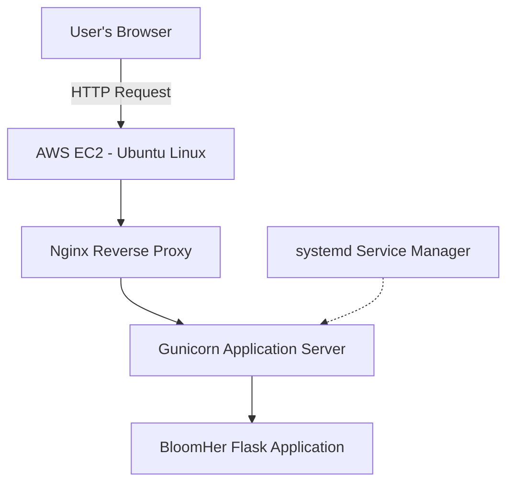

# 🌸 BloomHer — AWS DevOps Portfolio Project

**Python | Flask | Linux | AWS EC2 | Nginx | Gunicorn | Git | GitHub**
## BloomHer Application Screenshot

## Project Overview

BloomHer is an educational women's wellness application created as a hands-on cloud computing and DevOps portfolio project.

I used this project to practice Linux server administration, AWS EC2 application hosting, Python web development, version control, and troubleshooting.

## Application Features

- Accepts a starting menstrual period date and average cycle length.
- Calculates an estimated next period date.
- Displays estimated ovulation and fertile-window dates.
- Validates user input and displays error messages.
- Provides a responsive web interface.

## Technologies Used

| Technology | Purpose |
|---|---|
| AWS EC2 | Ubuntu cloud server |
| Ubuntu Linux | Server operating system |
| Python | Application programming |
| Flask | Backend web framework |
| HTML & CSS | User interface |
| Gunicorn | Python application server used in the EC2 lab |
| Nginx | Reverse proxy configured in the EC2 lab |
| Git | Source version control |
| GitHub | Remote repository and portfolio |

## Application Architecture

User's Browser → Nginx Reverse Proxy → Gunicorn → Python Flask Application

The architecture represents the EC2 application deployment practiced in the project.

## My DevOps Responsibilities

1. Connected to and administered an Ubuntu EC2 instance.
2. Installed and configured web application dependencies.
3. Practiced starting and managing application services.
4. Configured Nginx to forward web traffic to the application.
5. Verified HTTP responses and investigated service issues.
6. Initialized a Git repository for an existing project.
7. Configured `.gitignore` to exclude local files and sensitive information.
8. Created Git commits and pushed the project to GitHub.

## Project Structure

- `app/main.py` — Flask application logic
- `app/templates/index.html` — Application interface
- `website/index.html` — Additional website page
- `requirements.txt` — Python dependencies
- `.gitignore` — File exclusion rules

## Key Lessons Learned

## Linux Deployment and Troubleshooting

### Environment
- Cloud Platform: AWS EC2
- Operating System: Ubuntu Linux
- Web Server: Nginx
- Application Server: Gunicorn
- Backend: Python Flask
- Service Manager: systemd

### Commands Used to Verify Deployment

**Check Nginx service:**

`sudo systemctl status nginx --no-pager`

Result: Nginx active (running).

**Check BloomHer application service:**

`sudo systemctl status bloomher --no-pager`

Result: BloomHer active (running).

**Test the web server:**

`curl -I http://localhost`

Result: HTTP/1.1 200 OK.

**Verify Git repository status:**

`git status`

Result: Confirmed local project synchronization with GitHub before subsequent README updates.

### Deployment Verification

I confirmed that BloomHer was accessible through the EC2 public IP address using a web browser.

### Skills Demonstrated

- Linux service management
- Web application deployment
- HTTP connectivity testing
- Nginx reverse proxy configuration
- Git and GitHub version control
- Cloud application verification

### Security Considerations

The current demo was tested using HTTP. HTTPS, stronger access controls, and a production security review are future improvements. No real patient data should be entered into the demonstration.

This project helped me understand how a Python web application is hosted on a Linux server, how web servers communicate with backend applications, and how Git and GitHub support version control.

I also practiced Linux troubleshooting, file management, Git authentication, and remote repository publishing.

## Future Improvements

- Add automated application tests.
- Implement a Jenkins or GitHub Actions CI/CD pipeline.
- Containerize the current application with Docker.
- Add monitoring, secure HTTPS deployment, and deployment documentation.
- Expand the educational wellness features.

## Project Repository

https://github.com/vanoben23-cloud/bloomher-devops

**Disclaimer:** BloomHer is an educational demonstration. Its fertility calculations are estimates, not medical advice or reliable contraception guidance.
